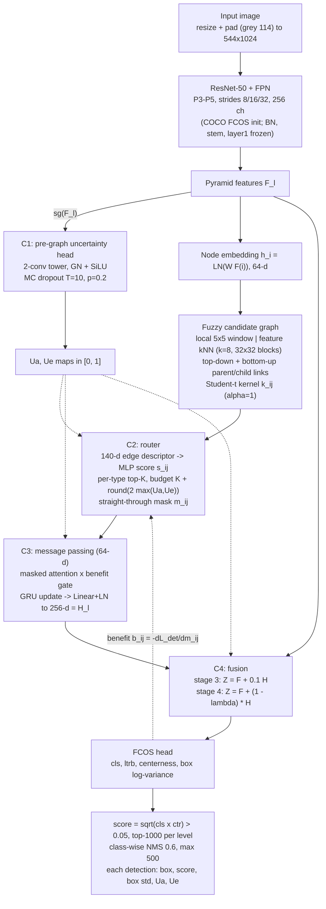
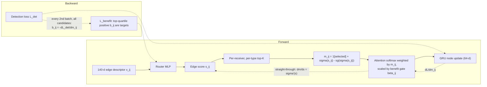
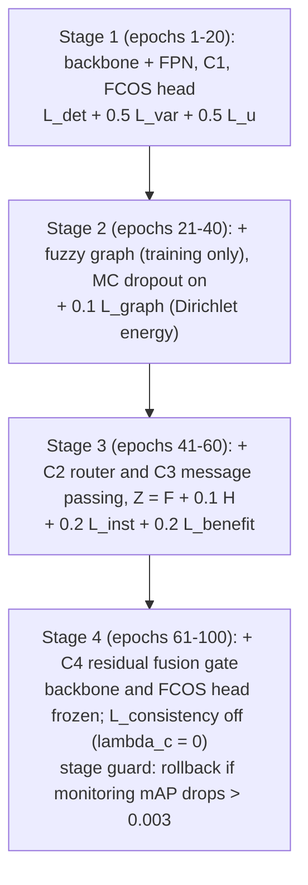

# UCR-MFG: Uncertainty-Conditioned Relational Routing over Multi-Scale Fuzzy Graphs for Object Detection in Drone Imagery

UCR-MFG is an anchor-free (FCOS) detector for drone imagery. It first measures its own uncertainty at every pyramid location and then uses that uncertainty to decide where relational context is needed. Each detection is returned with an aleatoric uncertainty ($U_a$), an epistemic uncertainty ($U_e$) and a per-side box standard deviation.

> **Paper results** (`paper/paper_6page.tex`). The model is trained and tested on **UAVDT** (3,318 test frames):
> - Without TTA: **17.5 mAP**, D-ECE 0.066.
> - With TTA: **18.9 mAP**.
> - AUROC of $U_a$ for separating false from true detections: **0.960**.
>
> The weights, results and commands are in [Section 7](#7-reproducing-the-paper-uavdt).

---

## 1. Core Contributions

- **C1: Pre-graph dual uncertainty head** (`src/models/uncertainty_head.py`)
  - Reads the detached FPN features $\mathrm{sg}(F_l)$ through a tower of two 3x3 convolutions with GroupNorm and SiLU.
  - Predicts class logits, centerness and a 4-sided box log-variance.
  - **Epistemic** $U_e$: normalised mutual information $\big(H(\bar p) - \overline{H}\big)/\log K$ over $T=10$ Monte Carlo inverted-dropout passes ($p=0.2$) with a seeded generator.
  - **Aleatoric** $U_a$: $\tfrac12\,\overline{H}/\log K + \tfrac12\,c\,v/(\sigma_0^2+v)$.
  - In stage 1 the dropout passes are skipped and $U_e = 0$.
- **C2: Uncertainty-conditioned router** (`src/models/router.py`)
  - Scores every candidate edge from a 140-d descriptor $[h_i, h_j, k_{ij}, U_a^i, U_e^i, U_a^j, U_e^j, g_{ij}, e_\tau]$: 64 + 64 + 1 + 4 + 3 + a 4-d type embedding.
  - Keeps a per-receiver, per-type top-K with budget $K_{i,\tau} = K_\tau + \mathrm{round}(2\max(U_a^i, U_e^i))$, where $(K_\text{local}, K_\text{kNN}, K_\text{td}, K_\text{bu}) = (4, 2, 2, 2)$.
  - A straight-through mask keeps the selection differentiable.
  - Supervised by an instance prior ($L_\text{inst}$) and by benefit distillation ($L_\text{benefit}$). Every 2nd batch, a dense pass measures $b_{ij} = -\partial L_\text{det}/\partial m_{ij}$ for all candidates; edges in the top quartile of positive benefits become router targets.
- **C3: Benefit-aware message passing** (`src/models/message_passing.py`)
  - Masked additive attention and a benefit gate $\beta_{ij} = \sigma(q_r^\top h_i + q_m^\top v_j + q_e^\top[s_{ij}, U_a^i, U_e^i, U_e^j])$ over the routed edges.
  - GRU node update in 64-d, then Linear + LayerNorm back to 256 channels, giving the graph features $H_l$.
- **C4: Residual uncertainty fusion gate** (`src/models/fusion.py`)
  - $Z_l = F_l + (1-\lambda_l)\odot H_l$, with $\lambda_l = \sigma(\phi([F_l, H_l, U_a, U_e]))$.
  - $\phi$ is two 1x1 convolutions (514 → 256 → 256) with GroupNorm and SiLU.
  - The last layer starts at zero weights and bias $\ln 9$, so stage 4 starts exactly at the stage-3 input $F + 0.1H$.
  - The convex gate $\lambda F + (1-\lambda) H$ (`mode: gate`) is kept as an ablation; it degraded training in stage 4.

---

## 2. Architecture & Dataflow

### Diagram 1: Forward pass


### Diagram 2: Straight-through routing & benefit distillation


### Diagram 3: UAVDT training curriculum (100 epochs)


Optimisation:
- AdamW with lr 1e-4 and weight decay 1e-4; cosine decay to 1e-6.
- Batch 2 with gradient accumulation 2; mixed precision; gradient clipping at 10.
- **Loss-spike guard:** skips a batch whose loss exceeds median + max(5 · 1.4826 · MAD, 2) over the last 200 batches, and skips an update whose gradient norm exceeds 5x its running median.
- **Box variance:** $\beta$-NLL ($\beta=0.5$) with a soft floor at −6.

---

## 3. Datasets

| Dataset | Used for | Status in this repository |
|---|---|---|
| **UAVDT** | Training and test for the paper | Present in `dataset/UAVDT-Benchmark-M/` |
| **VisDrone2019-DET** | Optional second pipeline (`src/data/visdrone.py`, `configs/experiments/visdrone_primary.yaml`) | Supported by the code but **not downloaded and not trained**; no paper result uses it |

**UAVDT setup used in the paper:**
- **Classes:** `car`, `truck`, `bus`.
- **Splits:** the official split, 30 training sequences (24,143 frames) and 20 test sequences (16,592 frames).
- **Training frames:** every 30th frame, 813 images.
- **Test frames:** every 5th test frame starting at the 3rd (stride 5, offset 2), 3,318 images with 75,152 vehicles.
- **Monitoring set** (validation during training and the stage guard): every 30th test frame, 559 images. 111 of them are also test frames.
- **TTA selection frames:** 554 test frames, disjoint from the 3,318.

Folder layout:
```
dataset/
├── UAVDT-Benchmark-M/
│   ├── M_attr/{train,test}/          # sequence split + weather / altitude tags
│   ├── UAV-benchmark-M/              # frames
│   └── UAV-benchmark-MOTD_v1.0/GT/   # *_gt_whole.txt, *_gt_ignore.txt
└── VisDrone2019-DET/                 # optional, not present
    └── VisDrone2019-DET-{train,val,test-dev}/{images,annotations}/
```
Downloads:
- UAVDT: https://sites.google.com/site/daviddo0323/
- VisDrone: https://github.com/VisDrone/VisDrone-Dataset

---

## 4. Environment Setup

```bash
# with uv
uv venv .venv --python 3.12 && source .venv/bin/activate
uv pip install -r requirements.txt

# or with pip
python3 -m venv .venv && source .venv/bin/activate
pip install -r requirements.txt
```
Requirements:
- torch ≥ 2.2, torchvision ≥ 0.17, numpy, scipy, pyyaml, scikit-learn, tqdm, pillow, matplotlib, pytest.
- Training used Apple MPS (`--device mps`). CUDA and CPU also work.

---

## 5. Unit Tests

```bash
pytest tests/          # 42 tests
```

| File | Checks |
|---|---|
| `test_dataset.py` | resize + pad, box and mask scaling, flip augmentation, collate |
| `test_data_validation.py` | train/test split isolation, degenerate-box detection |
| `test_uncertainty.py` | reproducible dropout, $U_a$/$U_e$ maps in [0, 1], $U_e = 0$ when epistemic is off |
| `test_graph.py` | candidate edges and Student-t weights, every fine node has a parent, pyramid round trip |
| `test_routing.py` | vectorised top-K = brute force, budgets and straight-through gradient, larger budgets for uncertain receivers, disabled router keeps all edges |
| `test_message_passing.py` | MPNN shapes and gradient, benefit gradient on unselected edges with no forward effect, fusion modes, gate initialisation |
| `test_consistency.py` | cross-scale KL consistency, empty and valid cases |
| `test_metrics.py` | mAP, ignore regions, uncertainty AUROC, benefit targets |
| `test_analysis.py` | AUROC, risk-coverage, reliability, uncertainty by occlusion, domain shift |
| `test_checkpoint.py` | atomic checkpointing and resumption, old-checkpoint purge |
| `test_resumable.py` | exact mid-epoch resume, per-epoch shuffling |
| `test_end_to_end.py` | a training step in every curriculum stage, inference with uncertainty |

---

## 6. Trained Models and Results

### Weights (`models/`)

| File | Model | Epoch | Test mAP | Test D-ECE |
|---|---|---|---|---|
| `models/stage1_ep020.pth` | FCOS + C1, no graph (**baseline** in paper Table IV) | 20 | 18.4 | 0.088 |
| `models/stage2_ep035.pth` | + fuzzy graph | 35 | 18.8 | 0.094 |
| `models/stage3_ep060.pth` | + C2 router, C3 message passing | 60 | 18.0 | 0.065 |
| `models/stage4_ep100_final.pth` | + C4 residual fusion, **final model** (used for all paper results) | 100 | 17.5 (18.9 with TTA) | 0.066 |

Every model is evaluated on the same 3,318 test frames with a single view unless noted. `models/README.md` says where each file came from. `saved_models/uavdt_ep54_before_collapse.pth` is the resume point for the final stage-4 run.

### Final model on the 3,318 test frames

| | mAP | AP50 | AP75 | APs | APm | APl | D-ECE |
|---|---|---|---|---|---|---|---|
| Without TTA | 17.5 | 32.4 | 17.4 | 11.0 | 29.1 | 30.1 | **0.066** |
| With TTA | **18.9** | **35.0** | **18.5** | **11.9** | **30.0** | **32.1** | 0.106 |

- **Per class AP (without / with TTA):** car 32.1 / 34.2, truck 5.6 / 6.0, bus 14.9 / 16.6.
- **AUROC for separating false from true detections (without TTA):** $U_a$ 0.960, $U_e$ 0.931, box std 0.975, 1 − score 0.970.
- **Speed:** 0.25 s per image on the M5 (MPS), including the 10 dropout passes.

### Where things are

| Folder | Content |
|---|---|
| `results/final_model/` | `test_single_view.json/.log` (without TTA), `test_tta.json/.log` (with TTA), TTA search (`stage4_end_tune*.json/.log`, 64 settings), chosen settings (`stage4_end_choice.json`, `single_view_choice.json`) |
| `results/stages/stage1..3/` | `test.json` + `test.log` for the stage 1-3 models |
| `results/demo/` | Single-image demo pictures |
| `checkpoints/<run>/` | Logs of each training run: `train_log.jsonl` (per-epoch losses, monitoring mAP/D-ECE), `stdout.log`, `spikes.jsonl`. Weights of finished runs were removed; the paper models are in `models/`. |
| `notebooks/` | `01_UCR_MFG_implementation.ipynb` (config, model and loss source, live forward pass, uncertainty maps) and `02_UCR_MFG_experiments_results.ipynb` (dataset, training curves, all result tables, AUROC, TTA, sample detections, speed), saved with outputs |
| `paper/` | `paper_6page.tex` and `figures/` (`architecture.png` = Fig. 1, `qualitative.png` = Fig. 2) |

Training runs in `checkpoints/`:
- `uavdt_primary/`: epochs 1-75. This covers stages 1-3; it also holds the failed stage-4 attempt with the convex gate and the loss collapse at epoch 55.
- `uavdt_stage4_frozen/`: stage 4 with the convex gate and a frozen detector. This design failed; the paper discusses it in Section IV-C.
- `uavdt_stage4_residual/`: the final stage 4 (epochs 61-100) with residual fusion, resumed from `saved_models/uavdt_ep54_before_collapse.pth`. `stage4_guard.json` records the rollback at epoch 65.
- `uavdt_stage1_rerun/`: stage 1 re-trained (epochs 1-20) with the final recipe. This is the baseline.

---

## 7. Reproducing the Paper (UAVDT)

### Step 1: Check the dataset
```bash
python scripts/validate_data.py --config configs/datasets/uavdt.yaml --split test --samples 500
```

### Step 2: Train
```bash
# Stages 1-3 (and the original stage 4); resume after Ctrl+C with --resume latest
python scripts/train.py --config configs/experiments/uavdt_primary.yaml --device mps

# Final stage 4 (residual fusion), from the epoch-54 checkpoint
python scripts/train.py --config configs/experiments/uavdt_stage4_residual.yaml \
  --resume saved_models/uavdt_ep54_before_collapse.pth --device mps

# Summarise a training log, flag plateaus
python scripts/check_plateau.py --log checkpoints/uavdt_stage4_residual/train_log.jsonl
```
All 100 epochs took 13.8 h on an Apple M5 (16 GB).

Resuming:
- `train.py` writes `latest.pth` every 500 batches (`--save-every N`; 0 disables) and on Ctrl+C. It also writes `interrupted.pth` on Ctrl+C. Press Ctrl+C twice to quit without saving.
- `--resume latest | best | <path>` continues from the exact epoch and batch. The optimiser, learning rate, AMP scaler, stage, RNG states and shuffle order are all restored.
- Use the same `--batch-size` and `--accumulate-grad-batches` as the saved run.

### Step 3: Evaluate on the 3,318 test frames
```bash
# WITHOUT TTA (single view)  -> 17.5 mAP, D-ECE 0.066
python scripts/tune_inference.py test --weights models/stage4_ep100_final.pth \
  --choice results/final_model/single_view_choice.json --stride 5 --offset 2

# WITH TTA (scales 1 + 1.25, flip, NMS 0.6, threshold 0.02)  -> 18.9 mAP, D-ECE 0.106
python scripts/tune_inference.py test --weights models/stage4_ep100_final.pth \
  --choice results/final_model/stage4_end_choice.json --stride 5 --offset 2

# Baseline / earlier stages (same protocol), e.g. the plain-detector baseline -> 18.4 mAP
python scripts/tune_inference.py test --weights models/stage1_ep020.pth \
  --choice results/final_model/single_view_choice.json --stride 5 --offset 2
```

### Step 4 (optional): Re-select the TTA setting
```bash
# 64 settings on the 554 selection frames (disjoint from the test frames), "robust" rule
python scripts/tune_inference.py tune --weights models/stage4_ep100_final.pth --out-dir results/final_model
```

### Step 5: Test on a single image

`scripts/demo_image.py` runs the final model on one image and saves a picture of its detections with their uncertainties.

```bash
# A UAVDT test frame, chosen by its index in the test split
python scripts/demo_image.py --index 2               # without TTA (single view)
python scripts/demo_image.py --index 2 --tta         # with TTA (setting used in the paper)
python scripts/demo_image.py --index 2 --compare     # both in one picture: single view (top), TTA (bottom)

# Any image of your own (JPG / PNG)
python scripts/demo_image.py --image path/to/photo.jpg
python scripts/demo_image.py --image path/to/photo.jpg --compare
```

| Mode | Command flag | What it does | Speed (CPU) |
|---|---|---|---|
| Without TTA | *(none)* | one forward pass on the image | ~0.8 s |
| With TTA | `--tta` | 4 views (original, flipped, 1.25x, 1.25x flipped), merged by NMS 0.6 | ~3.7 s |
| Compare | `--compare` | runs both and stacks them: without TTA (top), with TTA (bottom) | ~4.5 s |

TTA finds more vehicles, but its confidence scores are less well calibrated (D-ECE 0.106 vs 0.066). Use the model without TTA when the scores or uncertainties are passed on to a planner or operator.

| Option | Meaning | Default |
|---|---|---|
| `--score-thresh 0.3` | lower the confidence cutoff to draw more boxes | `0.5` |
| `--device mps` | run on the Mac GPU (faster) | `cpu` |
| `--weights <file>` | which trained model to use | `models/stage4_ep100_final.pth` |
| `--choice <file>` | TTA setting | `results/final_model/stage4_end_choice.json` |
| `--out <dir>` | output folder | `results/demo` |

Output:
- The terminal prints the number of detections per class and the run time. For example, `--index 2 --compare` gives 8 detections in 0.8 s without TTA and 14 in 3.7 s with TTA, on CPU.
- The picture is saved as `results/demo/<name>.png`, `<name>_tta.png` or `<name>_compare.png`.

Reading the picture:
- Box colours: green = car, orange = truck, blue = bus.
- Each label shows the score, $U_a$ and $U_e$.
- On test frames, ground-truth boxes are dashed white and ignore regions are shaded grey.

### Step 6: Paper figures and notebooks
```bash
python scripts/make_architecture_figure.py        # -> paper/figures/architecture.png (Fig. 1)
python scripts/make_qualitative.py --frames M0403_img000169 M1001_img000202 M1009_img000295 M0701_img000204
                                                  # -> paper/figures/qualitative.png (Fig. 2)
python scripts/make_notebooks.py                  # -> notebooks/*.ipynb, executed, with outputs
```
To open the notebooks: `pip install jupyter && jupyter notebook notebooks/`. They also render directly in VS Code and on GitHub.

### Step 7: Compile the paper
Upload `paper/paper_6page.tex` and the `paper/figures/` folder to Overleaf, or run `pdflatex paper_6page.tex` twice inside `paper/`.

---

## 8. Further Tools (not used for the paper results)

The code also contains a VisDrone pipeline and a larger experiment suite. These were **not run**, so no result in the paper or in `results/` comes from them.

| Tool | Command |
|---|---|
| VisDrone training (150 epochs: stages 1-30 / 31-60 / 61-90 / 91-150) | `python scripts/train.py --config configs/experiments/visdrone_primary.yaml` |
| General evaluation (VisDrone splits, UAVDT zero-shot, corruptions, MC-pass count) | `python scripts/eval.py --weights <ckpt> --config <exp.yaml> --split test [--corruption fog --severity 3] [--mc-passes 5]` |
| UAVDT zero-shot from a VisDrone model | `python scripts/eval.py --config configs/experiments/uavdt_zeroshot.yaml --weights checkpoints/visdrone_primary/best.pth --split test` |
| VisDrone index cache | `python -m src.data.build_cache --root dataset/VisDrone2019-DET --out .cache` |
| Router vs ground-truth oracle | `python scripts/oracle_router_pilot.py --weights <ckpt> --samples 50` |
| Ablation / baseline configs (11 variants, several seeds) | `python scripts/make_experiment_configs.py --seeds 42 43 44 --schedule full` |
| Evaluation suite for one model | `python scripts/run_paper_eval.py --weights <ckpt>` |
| Parameters, GFLOPs, latency | `python scripts/benchmark.py --weights <ckpt>` |
| Routed-edge visualisation | `python scripts/visualize.py --weights <ckpt> --num 6` |
| Tables and figures from that suite | `python scripts/make_paper_artifacts.py` |

The ablation switches are in `configs/model/*.yaml`:

| Switch | Ablation |
|---|---|
| `router.enabled: false` | dense graph: every candidate edge passes messages |
| `router.use_uncertainty: false` | router without $U_a$/$U_e$ in scores and budgets |
| `mpnn.benefit_gate: false` | message passing without the benefit gate |
| `fusion.mode: gate / fixed / add / residual` | convex gate / fixed 0.5 / plain addition / residual gate (the final model uses `residual`) |

---

## 9. Directory Structure

```
ucr_mfg/
├── configs/
│   ├── datasets/
│   │   ├── uavdt.yaml                  # UAVDT: 3 classes, 544x1024 canvas
│   │   └── visdrone.yaml               # optional VisDrone pipeline
│   ├── experiments/
│   │   ├── uavdt_primary.yaml          # UAVDT curriculum, stages 1-4 (paper)
│   │   ├── uavdt_stage4_residual.yaml  # final stage 4, residual fusion + stage guard
│   │   ├── uavdt_stage4_frozen.yaml    # stage 4, convex gate (failed design)
│   │   ├── uavdt_stage1_rerun.yaml     # stage-1 re-run = baseline
│   │   ├── uavdt_zeroshot.yaml         # VisDrone -> UAVDT zero-shot (not run)
│   │   └── visdrone_primary.yaml       # VisDrone curriculum (not run)
│   └── model/
│       ├── default.yaml                # convex gate, lambda_c = 0.1
│       └── residual.yaml               # final model: residual fusion, lambda_c = 0
├── dataset/                            # UAVDT-Benchmark-M (not in git)
├── src/
│   ├── data/
│   │   ├── dataset.py                  # common base dataset
│   │   ├── uavdt.py                    # UAVDT sequences, ignore regions, weather/altitude tags
│   │   ├── visdrone.py                 # VisDrone parser
│   │   ├── transforms.py               # aspect-ratio resize + pad (114)
│   │   ├── augmentations.py            # flip, brightness/contrast jitter
│   │   ├── corruptions.py              # blur, noise, fog, low light, contrast
│   │   ├── resumable.py                # seeded sampler for exact mid-epoch resume
│   │   ├── validation.py               # dataset audit
│   │   ├── build_cache.py              # VisDrone index cache
│   │   └── collate.py                  # batch collation
│   ├── models/
│   │   ├── backbone.py                 # ResNet-50 + FPN (P3-P5, 256 ch)
│   │   ├── uncertainty_head.py         # C1: Ua, Ue (MC dropout)
│   │   ├── graph_builder.py            # multi-scale fuzzy candidate graph, Student-t kernel
│   │   ├── router.py                   # C2: 140-d router, typed top-K, straight-through mask
│   │   ├── message_passing.py          # C3: benefit-aware MPNN (64-d -> 256-d)
│   │   ├── fusion.py                   # C4: residual / convex / fixed / add fusion
│   │   ├── detection_head.py           # FCOS head with box log-variance
│   │   ├── graph_ops.py                # graph containers, segment softmax, pyramid reshaping
│   │   ├── postprocess.py              # decoding + NMS, per-detection Ua, Ue, box std
│   │   └── ucr_mfg.py                  # full staged detector
│   ├── losses/
│   │   ├── detection_loss.py           # focal + CIoU + centerness
│   │   ├── uncertainty_loss.py         # beta-NLL box variance (soft floor) + class NLL
│   │   ├── graph_loss.py               # Dirichlet energy
│   │   ├── router_loss.py              # instance prior + benefit distillation
│   │   ├── consistency_loss.py         # cross-scale KL (implemented, off in final model)
│   │   └── total_loss.py               # stage-aware total loss
│   ├── analysis/uncertainty.py         # AUROC, risk-coverage, reliability, domain shift
│   ├── engine.py                       # target assignment, benefit measurement, eval loop
│   ├── evaluation.py                   # checkpoint loading, dataset/eval helpers
│   └── utils/
│       ├── checkpoint.py               # atomic saves, full training state
│       ├── progress.py                 # live terminal progress
│       ├── metrics.py                  # COCO mAP, D-ECE, AUROC
│       └── bootstrap.py                # paired bootstrap, Holm-Bonferroni
├── scripts/
│   ├── train.py                        # curriculum training, spike guard, stage guard, resume
│   ├── tune_inference.py               # UAVDT test evaluation + TTA selection (paper numbers)
│   ├── demo_image.py                   # single image, with / without TTA
│   ├── check_plateau.py                # summarise train_log.jsonl
│   ├── validate_data.py                # dataset audit CLI
│   ├── make_architecture_figure.py     # paper Fig. 1
│   ├── make_qualitative.py             # paper Fig. 2
│   ├── make_notebooks.py               # builds notebooks/*.ipynb with outputs
│   ├── eval.py                         # general evaluation (Section 8)
│   ├── run_paper_eval.py               # evaluation suite (Section 8)
│   ├── make_experiment_configs.py      # ablation configs (Section 8)
│   ├── make_paper_artifacts.py         # suite tables/figures (Section 8)
│   ├── benchmark.py                    # params, GFLOPs, latency
│   ├── visualize.py                    # routed-edge visualisation
│   └── oracle_router_pilot.py          # router vs ground-truth oracle
├── tests/                              # 12 files, 42 tests
├── models/                             # paper weights, one per stage (+ README.md)
├── saved_models/                       # uavdt_ep54_before_collapse.pth (resume point)
├── checkpoints/                        # training logs per run
├── results/
│   ├── final_model/                    # test results with / without TTA, TTA search
│   ├── stages/                         # stage 1-3 test results
│   └── demo/                           # demo pictures
├── notebooks/                          # implementation + results notebooks (with outputs)
├── paper/
│   ├── paper_6page.tex                 # IEEE 6-page paper
│   └── figures/                        # architecture.png, qualitative.png
├── pyproject.toml
├── requirements.txt
└── README.md
```
