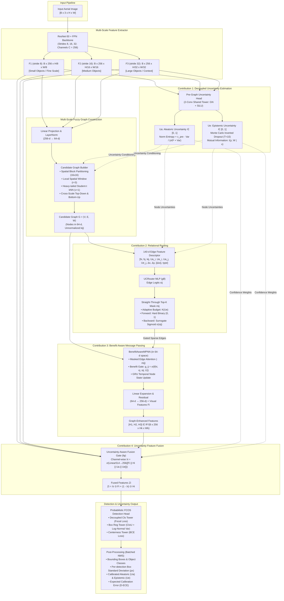
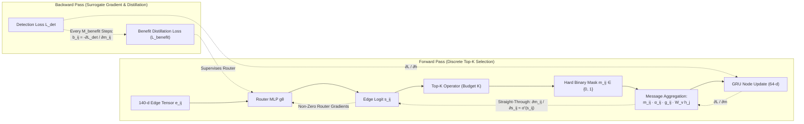
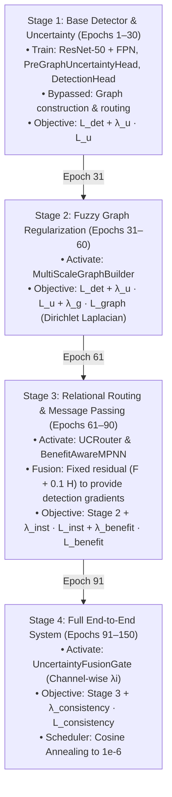

# UCR-MFG: Uncertainty-Conditioned Relational Routing for Multi-Scale Fuzzy Graph Object Detection

An uncertainty-aware, graph-enhanced object detection architecture for aerial and drone imagery using **VisDrone2019-DET**, with zero-shot cross-domain generalization on **UAVDT**, and optional independent experiment tracks for **DOTA-v1.5** and **SODA-A**.

---

## 1. Research Overview & Core Contributions

UCR-MFG addresses high visual ambiguity, extreme scale variation, and dense object clusters in low-altitude aerial imagery through four research-grade components:

- **C1: Dual Predictive Uncertainty Modeling (`src/models/uncertainty_head.py`)**
  - **Aleatoric Uncertainty ($U^a \in [0, 1]$):** Expected entropy over $T$ MC-dropout passes, $\mathbb{E}_t[H(p_t)]$, blended with a centerness-weighted box variance.
  - **Epistemic Uncertainty ($U^e \in [0, 1]$):** Mutual information $H(\mathbb{E}_t[p_t]) - \mathbb{E}_t[H(p_t)]$ from Monte Carlo inverted dropout ($T=10$) with reproducible per-batch generators.
  - Every detection is returned with its $U^a$, $U^e$ and a box standard deviation from the probabilistic head (log-normal box model).
- **C2: Uncertainty-Conditioned Relational Routing (`src/models/router.py`)**
  - Scores every candidate edge from a 140-d descriptor (receiver/sender features, Student-t affinity, $U^a$/$U^e$ of both ends, geometry, edge type).
  - Vectorised per-receiver, per-type Straight-Through Top-K whose budget grows with receiver uncertainty.
  - Supervised by weak instance BCE ($L_{\text{inst}}$) and benefit distillation ($L_{\text{benefit}}$): every `benefit_step_interval` steps a dense pass measures $b_{ij} = -\partial L_{\text{det}} / \partial m_{ij}$ for all candidates.
- **C3: Benefit-Aware Multi-Scale Message Passing (`src/models/message_passing.py`)**
  - Masked attention plus a benefit gate $g_{ij} = \sigma(f(h_i, v_j, s_{ij}, U^a_i, U^e_i, U^e_j))$ over routed edges only, a GRU node update in 64-d and expansion back to $C=256$.
  - Cross-scale edges link every fine location to its parent and every parent to all four children.
  - Regularized by object-centric cross-scale prediction KL consistency ($L_{\text{consistency}}$) with collision resolution and NaN-safe autograd protection.
- **C4: Uncertainty-Aware Feature Fusion (`src/models/fusion.py`)**
  - Channel-wise gate $\boldsymbol{\lambda}_i \in (0, 1)^{256}$ predicted from $[F, H, U^a, U^e]$, initialised to favour the visual features.

---

## 2. Working Architecture & Dataflow Diagrams

### Diagram 1: Full System Forward Pass & Module Interactions


### Diagram 2: Straight-Through Top-K Routing & Benefit Distillation Flow


### Diagram 3: 4-Stage Progressive Curriculum & Loss Schedule


---

## 3. Dataset Strategy & Operational Roles

| Dataset | Role | Priority | Annotation Format | Ground-Truth Splits on Disk | Operational Purpose |
|---|---|---|---|---|---|
| **VisDrone2019-DET** | Primary Development, Training, In-Domain Eval | **Mandatory** | HBB (`[bbox_left, bbox_top, width, height, score, category, trunc, occ]`) | `train` (6,471 imgs), `val` (548 imgs), `test-dev` (1,610 imgs) | Primary benchmark for architecture design, 4-stage curriculum (Epochs 1–150), loss sweeps, and 13-rung ablation ladder. Preserves ignore regions (`category == 0`). |
| **UAVDT** | Cross-Domain Generalization | **Recommended** | HBB (`*_gt_whole.txt` + `*_gt_ignore.txt`) | 50 sequences: 30 `train`, 20 `test` via `M_attr` | Measures zero-shot out-of-domain transfer from VisDrone under differing camera angles and altitudes without fine-tuning. Evaluated over unified 3-class vehicle ontology (`car`, `truck`, `bus`). |
| **DOTA-v1.5** | Aerial & Satellite Imagery | **Optional** | OBB ($x_1, y_1 \dots x_4, y_4$) converted to HBB envelope | `train` (469 imgs), `validation` (458 imgs), `test` (469 imgs) | Optional independent training and evaluation on overhead satellite imagery using documented OBB-to-HBB conversion. Local validation on `validation/images`. |
| **SODA-A** | Small-Object Specialized Benchmark | **Optional** | COCO-style / SODA JSON | `train` (2,384 imgs), `test` (130 imgs); 2,513 in `Images.zip` | Optional independent diagnostic for extreme small objects ($< 15$ to $30$ px). Staged without blocking VisDrone development. |

> [!NOTE]
> **No Dataset Mixing in Training:** VisDrone2019-DET is the **sole** primary training dataset. UAVDT remains completely unseen during training and is strictly evaluated zero-shot to assess generalization. DOTA-v1.5 and SODA-A are isolated as independent experiment tracks.

---

## 4. Dataset Download Links & Folder Setup

Place datasets in the `dataset/` root directory following this exact structure:

```
dataset/
├── VisDrone2019-DET/
│   ├── VisDrone2019-DET-train/
│   │   ├── images/
│   │   └── annotations/
│   ├── VisDrone2019-DET-val/
│   │   ├── images/
│   │   └── annotations/
│   ├── VisDrone2019-DET-test-dev/
│   │   ├── images/
│   │   └── annotations/
│   └── VisDrone2019-DET-test-challenge/
│       └── images/
├── UAVDT-Benchmark-M/
│   ├── M_attr/
│   │   ├── train/
│   │   └── test/
│   ├── UAV-benchmark-M/
│   └── UAV-benchmark-MOTD_v1.0/
│       └── GT/
├── DOTA-v1.5/
│   ├── train/images/
│   ├── validation/images/
│   └── test/images/
└── SODA-A/
    ├── train/
    ├── test/
    └── Images.zip
```

### Official Download Portals:
- **VisDrone2019-DET:** [http://aiskyeye.com/](http://aiskyeye.com/) or GitHub: [https://github.com/VisDrone/VisDrone-Dataset](https://github.com/VisDrone/VisDrone-Dataset)
- **UAVDT Benchmark:** [https://sites.google.com/site/daviddo0323/](https://sites.google.com/site/daviddo0323/)
- **DOTA-v1.5:** [https://captain-whu.github.io/DOTA/dataset.html](https://captain-whu.github.io/DOTA/dataset.html)
- **SODA-A:** [https://shaosu.site/SODA/](https://shaosu.site/SODA/)

---

## 5. Environment Setup

### Using `uv` (Recommended — 2-second setup):
```bash
# Create virtual environment with Python 3.12
uv venv .venv --python 3.12
source .venv/bin/activate

# Install dependencies
uv pip install -r requirements.txt
```

### Using standard `pip`:
```bash
python3 -m venv .venv
source .venv/bin/activate
pip install -r requirements.txt
```

---

## 6. Verification & Unit Testing

Run the full automated verification test suite:
```bash
pytest tests/
```
The test suite covers:
1. `tests/test_dataset.py`: Coordinate scaling, aspect-ratio padding, flip augmentations, collate function, and DOTA OBB-to-HBB conversion.
2. `tests/test_data_validation.py`: 10-point data audit, degenerate box filtering, and train/val split isolation.
3. `tests/test_uncertainty.py`: Reproducible generator-aware inverted dropout and bounded uncertainty outputs ($U^a, U^e \in [0, 1]$).
4. `tests/test_graph.py`: Candidate graph construction, spatial block partitioning, and Student-t weights.
5. `tests/test_routing.py`: Non-zero Straight-Through surrogate gradient flow into router logits ($\frac{\partial L}{\partial s_{ij}} \neq 0$).
6. `tests/test_message_passing.py`: Masked attention in 64-d space, benefit message gates, GRU update, and linear expansion to 256-d.
7. `tests/test_fusion.py`: Channel-wise fusion gate bounds and feature recombination.
8. `tests/test_consistency.py`: Object-centric prediction KL consistency with NaN-safe empty set autograd attachment.
9. `tests/test_checkpoint.py`: Atomic persistence, PRNG restoration, momentum preservation, and checkpoint retention.
10. `tests/test_end_to_end.py`: Multi-stage forward and backward propagation through all curriculum stages.

---

## 7. Step-by-Step Execution Guide

### Step 1: Run 10-Point Dataset Validation
Audit dataset splits before training:
```bash
# Validate VisDrone validation set
python scripts/validate_data.py --config configs/datasets/visdrone.yaml --split val --samples 548

# Validate UAVDT test set
python scripts/validate_data.py --config configs/datasets/uavdt.yaml --split test --samples 500
```

### Step 2: (Optional) Precompute Metadata Cache
Pre-index VisDrone for faster epoch initialization:
```bash
python src/data/build_cache.py --root dataset/VisDrone2019-DET --out .cache
```

### Step 3: Train Primary UCR-MFG Model on VisDrone
Execute the 4-stage 150-epoch progressive curriculum:
```bash
python scripts/train.py --config configs/experiments/visdrone_primary.yaml
```
- **Live Terminal Display:** Shows an animated progress bar, epoch count, batch progress, elapsed time, epoch ETA, loss breakdown, learning rate, and GPU/VRAM memory.
- **Stage Progression:**
  - **Stage 1 (Epochs 1–30):** Backbone, FPN, PreGraphUncertaintyHead, and DetectionHead ($L_{\text{det}} + \lambda_u L_u$).
  - **Stage 2 (Epochs 31–60):** Enables GraphBuilder ($+ \lambda_g L_{\text{graph}}$).
  - **Stage 3 (Epochs 61–90):** Enables UCRouter and BenefitAwareMPNN; the head sees $F + 0.1 H$ so routing receives a detection signal ($+ \lambda_{\text{inst}} L_{\text{inst}} + \lambda_{\text{benefit}} L_{\text{benefit}}$ every 2 steps).
  - **Stage 4 (Epochs 91–150):** Enables the UncertaintyFusionGate ($+ \lambda_c L_{\text{consistency}}$) with cosine annealing to $10^{-6}$.
- **Validation:** VisDrone val mAP every `val.interval` epochs; the best model is saved as `best.pth`.

### Step 4: Resume Interrupted Training
The checkpoint engine atomically writes `latest.pth` and `best.pth`. If a job is preempted or stopped with `Ctrl+C`:
```bash
# Resume from latest completed epoch
python scripts/train.py --config configs/experiments/visdrone_primary.yaml --resume latest

# Or resume from a custom checkpoint path
python scripts/train.py --config configs/experiments/visdrone_primary.yaml --resume checkpoints/visdrone_primary/epoch_045.pth
```
Training continues from the exact epoch **and batch** that was saved; completed batches are skipped without being loaded.
- **Ctrl+C / SIGTERM:** finishes the current optimizer step, saves `latest.pth` and `interrupted.pth`, and exits. Press Ctrl+C twice to quit immediately without saving.
- **Periodic saves:** `latest.pth` is also written every `checkpoint.save_every_steps` batches (default 500; override with `--save-every N`, `0` disables), so a crash or power loss costs at most that many batches.
- **Exact continuation:** the shuffle order depends only on (seed, epoch) and each sample's augmentation has its own seed, so the resumed batches are the ones the interrupted run would have seen. Optimizer momentum, learning rate, AMP scaler, curriculum stage, running epoch losses and RNG states are restored.
- Resume with the same `--batch-size` and `--accumulate-grad-batches` as the saved run; a mismatch is rejected.

### Step 5: Zero-Shot Cross-Domain Evaluation on UAVDT
Evaluate the frozen VisDrone model on UAVDT test sequences without fine-tuning:
```bash
python scripts/eval.py \
  --config configs/experiments/uavdt_zeroshot.yaml \
  --weights checkpoints/visdrone_primary/best.pth \
  --split test
```
Reports COCO-style mAP@[.5:.95], AP50, AP75, APs/APm/APl, D-ECE and the AUROC of $U^a$, $U^e$, box std and $1 -$ score for separating false from true detections, over the mapped 3-class vehicle ontology (`car`, `truck`, `bus`). The model and curriculum stage are rebuilt from the checkpoint.

### Step 6: In-Domain Test-Dev Evaluation
Run the final one-time blind evaluation on VisDrone `test-dev`:
```bash
python scripts/eval.py \
  --config configs/experiments/visdrone_primary.yaml \
  --weights checkpoints/visdrone_primary/best.pth \
  --split test_dev
```

### Step 7: Ablations and Router Diagnostic
Ablation switches live in `configs/model/default.yaml`:

| Switch | Ablation |
|---|---|
| `router.enabled: false` | Dense MFG graph, every candidate edge passes messages |
| `router.use_uncertainty: false` | Router without $U^a$/$U^e$ (scores and budgets) |
| `mpnn.benefit_gate: false` | Message passing without the benefit gate |
| `fusion.mode: fixed` / `add` | Fixed 0.5 fusion / plain addition instead of the C4 gate |

```bash
python scripts/oracle_router_pilot.py --weights checkpoints/visdrone_primary/best.pth --samples 50
```
Compares router precision/recall against a ground-truth same-object oracle per edge type.

### Step 8: Paper Experiments, Tables and Figures
Every number in the paper tables comes from a measured result file. Missing results are shown as `—`, evaluations on image subsets are excluded, and external baselines appear only with a cited source.

```bash
# 1. Training configs for the full model, two in-house baselines and nine ablations (3 seeds; "short" = 50 epochs)
python scripts/make_experiment_configs.py --seeds 42 43 44 --schedule full
python scripts/train.py --config configs/paper/paper_ucr_mfg_full_s42.yaml        # repeat for each config

# 2. All evaluations for one trained model: val, test-dev, UAVDT zero-shot, 6 corruptions x 3 severities
python scripts/run_paper_eval.py --weights checkpoints/paper/paper_ucr_mfg_full_s42/best.pth
python scripts/eval.py --weights <best.pth> --split test_dev --mc-passes 1     # optional: T sensitivity (also 2, 5)

# 3. Cost, qualitative figures, then every table, figure and a status checklist
python scripts/benchmark.py --weights checkpoints/paper/*/best.pth
python scripts/visualize.py --weights checkpoints/paper/paper_ucr_mfg_full_s42/best.pth --num 6
python scripts/make_paper_artifacts.py            # -> paper/tables/*.md|.tex, paper/figures/*.pdf|.png, paper/STATUS.md
```

| Output | Content |
|---|---|
| `main_visdrone` | test-dev comparison: external baselines (`results/external_baselines.yaml`), detector-only, MFG-style, UCR-MFG |
| `ablations` | nine ablations on val with Δ mAP and paired bootstrap p-values (Holm–Bonferroni) |
| `uavdt_zero_shot` | zero-shot transfer overall and per weather (daylight / night / fog) and altitude |
| `occlusion` | AP50 and recall per VisDrone occlusion level |
| `robustness` | mAP under blur, motion blur, noise, fog, low light and low contrast |
| `uncertainty` | D-ECE, error-detection AUROC, AURC, OOD AUROC of $U^e$ (VisDrone vs UAVDT) |
| `efficiency`, `mc_passes` | parameters, GFLOPs, latency, routed edges; effect of the number of MC passes |
| figures | reliability, risk–coverage, uncertainty vs occlusion, domain shift, robustness, training curves, qualitative |

`paper/STATUS.md` lists what is still missing: untrained or incomplete runs, single-seed rows, missing evaluations, frame-strided UAVDT, uncommitted code and unsourced baselines.

---

## 8. Directory Structure

```
ucr_mfg/
├── configs/
│   ├── datasets/
│   │   ├── visdrone.yaml
│   │   ├── uavdt.yaml
│   │   ├── dota_v1_5.yaml
│   │   └── soda_a.yaml
│   ├── experiments/
│   │   ├── visdrone_primary.yaml
│   │   ├── uavdt_zeroshot.yaml
│   │   ├── dota_independent.yaml
│   │   └── soda_independent.yaml
│   └── model/
│       └── default.yaml
├── dataset/                    # Local dataset folder (symlinked or downloaded)
├── src/
│   ├── data/
│   │   ├── dataset.py          # Common BaseDataset interface
│   │   ├── visdrone.py         # VisDrone parser & ignore masks
│   │   ├── uavdt.py            # UAVDT sequence parser & vehicle ontology
│   │   ├── dota.py             # DOTA parser & OBB-to-HBB conversion
│   │   ├── soda_a.py           # SODA-A parser & validator
│   │   ├── transforms.py       # Aspect-ratio padding & coordinate scaling
│   │   ├── augmentations.py    # Training augmentations (disjoint from eval)
│   │   ├── validation.py       # 10-point data validation engine
│   │   ├── build_cache.py      # Precomputed metadata cache
│   │   └── collate.py          # Batch collation
│   ├── models/
│   │   ├── backbone.py         # ResNet-50 + FPN (C=256, strides 8, 16, 32)
│   │   ├── uncertainty_head.py # C1: Decoupled PreGraphUncertaintyHead (Ua, Ue)
│   │   ├── graph_builder.py    # Spatial block partitioning & Student-t kernel
│   │   ├── router.py           # C2: 140-d UCRouter with Straight-Through Top-K
│   │   ├── message_passing.py  # C3: BenefitAwareMPNN (64-d attention -> 256-d expansion)
│   │   ├── fusion.py           # C4: UncertaintyFusionGate (channel-wise lambda_i)
│   │   ├── detection_head.py   # Probabilistic FCOS head (cls, ltrb, centerness, box log-variance)
│   │   ├── graph_ops.py        # Graph/Routing containers, segment softmax, pyramid reshaping
│   │   ├── postprocess.py      # Decoding + NMS with per-detection uncertainty
│   │   └── ucr_mfg.py          # End-to-end staged UCR-MFG detector
│   ├── losses/
│   │   ├── detection_loss.py   # Focal + CIoU + Centerness
│   │   ├── uncertainty_loss.py # Log-space box NLL + Cls NLL
│   │   ├── graph_loss.py       # Dirichlet Laplacian Energy
│   │   ├── router_loss.py      # Weak instance BCE + Benefit distillation
│   │   ├── consistency_loss.py # Object-centric prediction KL consistency
│   │   └── total_loss.py       # Multi-task objective for all 4 curriculum stages
│   ├── engine.py               # Target assignment, benefit measurement, evaluation loop
│   └── utils/
│       ├── checkpoint.py       # Atomic saving, full state, graceful interrupt
│       ├── progress.py         # Live terminal animated progress display
│       ├── metrics.py          # COCO-style mAP, D-ECE, uncertainty AUROC
│       └── bootstrap.py        # Paired bootstrap test & Holm-Bonferroni correction
├── scripts/
│   ├── train.py                # 4-stage training script with resume support
│   ├── eval.py                 # Evaluation script for VisDrone, UAVDT, DOTA
│   ├── validate_data.py        # CLI dataset integrity audit tool
│   └── oracle_router_pilot.py  # Diagnostic GT-instance upper bound
├── tests/                      # Automated test suite
├── pyproject.toml              # Project metadata & pytest configuration
├── requirements.txt            # Python dependencies
└── README.md                   # Complete reproduction & execution guide
```

